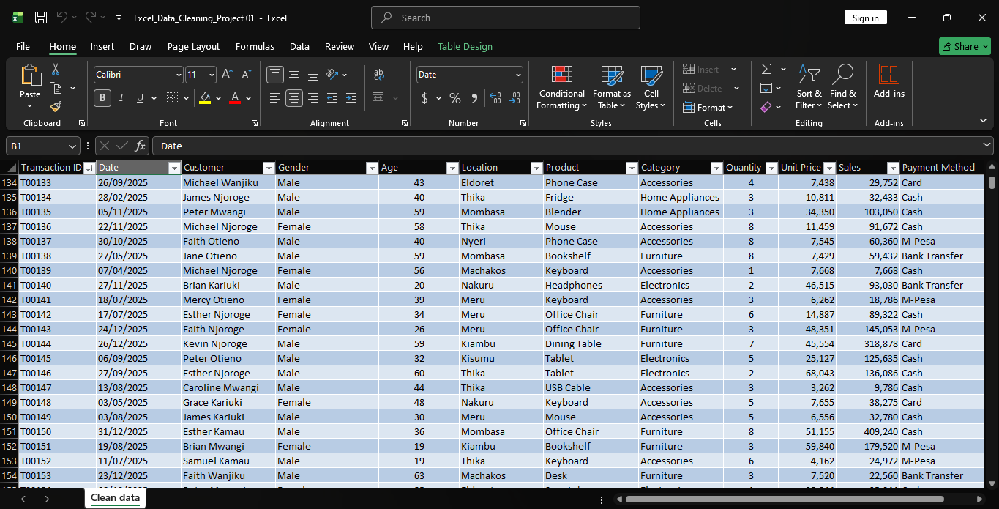

# Excel-data-cleaning-project
An Excel data cleaning and sales analysis project focused on identifying duplicates, handling missing values, standardizing inconsistent data, validating records, and preparing a 10,000+ row sales dataset for analysis.

The project investigated the following issues:

1.Duplicate and potentially duplicated transactions

2.Missing customer information and ages

3.Inconsistent location and payment method labels

4.Invalid age and quantity values

5.Numerical values stored as text

6.Sales values that may not match the expected calculation

Each issue was assessed before corrective action was taken to avoid removing valid information or introducing unsupported assumptions.
#raw data visual

#Clean data visual

